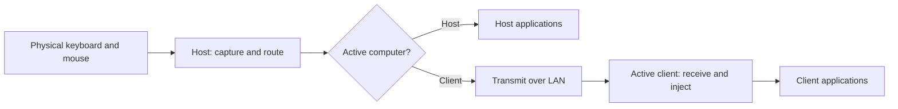
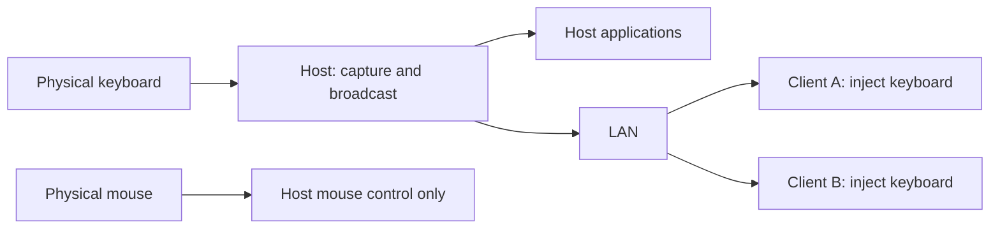
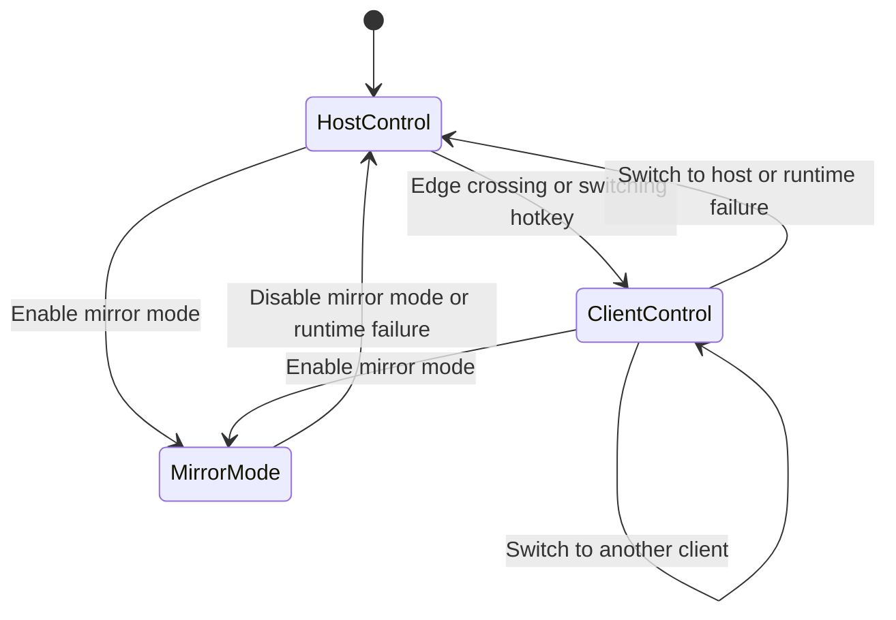

# ShareKeys

A network-based software KVM for trading desks. One keyboard and mouse connected to a **host** can control multiple independent **client computers** over a trusted LAN.

Each computer runs its own applications and drives its own monitors. ShareKeys transfers input only; **screen streaming is outside scope**.

This README describes the intended first version, not implemented functionality.

## Scope and stack

- **Windows only** for the first version.
- **C++:** input capture, routing, networking, and Windows input injection.
- **Qt:** configuration and status interface.
- **Deskflow:** selected parts of its codebase will be reused; integration details remain to be decided.
- **Trusted LAN:** computers communicate directly within the local network.

## Control modes

| Behavior | Individual control | Mirror mode |
|---|---|---|
| Keyboard | Goes to the active computer | Goes to the host and participating clients |
| Mouse movement, clicks, dragging, and scrolling | Go to the active computer | Work locally on the host; never transmitted to clients |
| Host input while a client is active | Ordinary keyboard and mouse input is suppressed locally | Host receives keyboard input and keeps normal local mouse control |
| Exit or runtime failure | Runtime failure returns control to the host | Leaving mirror mode or encountering a runtime failure returns control to the host |

**Mirror mode mirrors the keyboard only. The host mouse remains operational, and client cursors do not move in response to it.**

### Individual control

Only one computer receives ordinary input at a time. Keyboard input follows the active computer; it has no separate position. Mouse tracking identifies the active computer, active monitor, and cursor position.

A configured monitor layout defines how control moves between computers. Crossing a configured screen edge is the intended switching mechanism; hotkeys provide another way to switch.

When a client is active, ordinary input reaches that client without also triggering actions in host applications. Other clients receive no forwarded input.

### Mirror mode

Keyboard events are delivered to the host and all participating clients. Mouse input stays local to the host, including clicks, dragging, and scrolling. Mouse edge crossing does not transfer control while mirroring.

Mirroring reproduces keyboard input, not application state. Results depend on each computer's focused application, keyboard layout, and current state. Host mouse clicks do not change focus on clients.

## Program logic

The input pipeline is:

**Capture → choose destinations → transmit → receive → inject.**

Local host input follows the selected mode without a network round trip.

1. The host captures physical input and checks the current control mode.
2. In individual mode, it routes input to the active computer and tracks mouse position against the configured monitor layout.
3. In mirror mode, it broadcasts keyboard input to participating clients while keeping keyboard and mouse input available locally on the host.
4. Clients receive ordered events and inject them into Windows so applications can respond as they would to local input.
5. Switching and recovery must account for held keys and mouse buttons to prevent stuck modifiers or dragging. Injected events must not be captured and forwarded again.
6. Leaving mirror mode or encountering a runtime failure restores individual control on the host. Failure recovery must release tracked held input where possible and restore local controls.

The Qt interface configures computers, monitor layout, switching hotkeys, and mirror participants, and displays connection and control status. The C++ engine owns input handling and mode transitions.

## Likely use cases

- **Multi-computer trading desk:** move between trading terminals, research tools, and monitoring systems using one keyboard and mouse.
- **Separate application environments:** control computers with independent workloads while retaining their local displays and applications.
- **Repeated keyboard workflows:** send the same shortcuts or text to prepared applications on several computers through keyboard-only mirroring.

Mirror mode requires care for actions such as order entry: identical keys can produce different outcomes when application focus or state differs. It does not synchronize trades or confirm application results.
