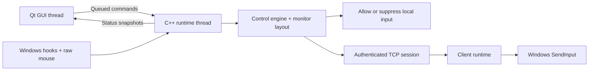

# Architecture

The GUI owns a dedicated runtime QThread. Windows hooks, monitor tracking, state
transitions, and nonblocking TCP sockets run in that thread. Input hooks never
wait for the GUI or for network delivery. There is no screen or clipboard transport.

## Routing

`ControlEngine` chooses destinations and tracks held keys/buttons. Individual
mode allows local input on the host or suppresses it while routing to one client.
Mirror mode permits host input and broadcasts only keys to selected clients.
All mouse input stays on the host in mirror mode, and edges do not switch computers.

`Runtime` applies decisions, manages sessions, handles hotkeys, and publishes
status. A transition releases held input at old destinations and quarantines
physically held keys/buttons until their release. Repeats cannot leak into the new
computer. Dragging works within the active computer; crossing computers releases
the drag and requires a fresh press. Turning off mirror always selects the host.

## Windows input and coordinates

Low-level keyboard and mouse hooks suppress ordinary local events when a client
is active. Raw Input supplies relative mouse movement even at a desktop boundary.
Injected events are excluded from capture to avoid forwarding loops. The client
uses scan codes for physical key identity, with virtual-key fallback for Pause and
keys lacking scan codes. Text follows the destination keyboard layout; this is not
Unicode text synchronization. Keyboard toggle state is not synchronized.

The app declares per-monitor DPI awareness and enumerates native monitor rectangles.
The host maintains a virtual cursor on the configured layout, one layout unit per
native pixel. Remote movement is converted to absolute desktop coordinates, avoiding
a second application of the client's mouse acceleration. Raw relative counts map
one-to-one to remote pixels; local Windows pointer acceleration remains local.
Client cursor reports update displayed status independently of outgoing routing.

Touching edges switch destinations. Gaps and non-overlapping edge spans block
crossing. Movement can slide along a blocked edge. A short switching cooldown avoids
bouncing straight back. Monitor configuration changes stop sharing and require a
restart to advertise new geometry. Relative mouse devices are supported; absolute
pen/tablet devices are not currently forwarded as remote pointer movement.

## Sessions and recovery

See [protocol.md](protocol.md). Peers send a heartbeat every 500 ms. A 3-second
receive timeout, invalid message, failed injection, disconnection, or stalled write
restores host control. Every client maintains its own injected-held-input ledger
and releases it on stop or session loss. It retries failed releases while the
client remains open and the desktop becomes accessible again.

The host releases local suppression before attempting network cleanup. A failure
in release delivery cannot prevent local recovery. Returning home also sends reset
messages to connected clients. No application keystrokes are written to activity logs.

The GUI and input runtime are separate; hooks and network work share the runtime
thread. This prevents GUI stalls from blocking capture, but an entire process hang
or forced client termination is outside graceful recovery. Windows can silently
remove a hook if its callback times out. Physical acceptance and load testing are
required; this application is not certified for trading execution.

## Deskflow reuse and boundaries

The Windows mouse-button encoder is adapted from Deskflow, including swapped-button
handling. [Source attribution and licenses](../third_party/deskflow/README.md) pin
the upstream revision and describe the modifications. ShareKeys uses its own session
protocol and is not wire-compatible with Deskflow.

Current scope is logged-in Windows desktop applications. Windows secure desktops,
login screens, Ctrl+Alt+Delete, and guaranteed control of higher-integrity applications
are not supported. Injection obeys Windows permission boundaries. Mirroring sends
keys to the current focus on each computer; it does not synchronize focus or trades.

References: [Microsoft input hooks](https://learn.microsoft.com/en-us/windows/win32/winmsg/lowlevelmouseproc),
[Raw Input](https://learn.microsoft.com/en-us/windows/win32/api/winuser/ns-winuser-rawmouse),
and [SendInput permissions](https://learn.microsoft.com/en-us/windows/win32/api/winuser/nf-winuser-sendinput).
